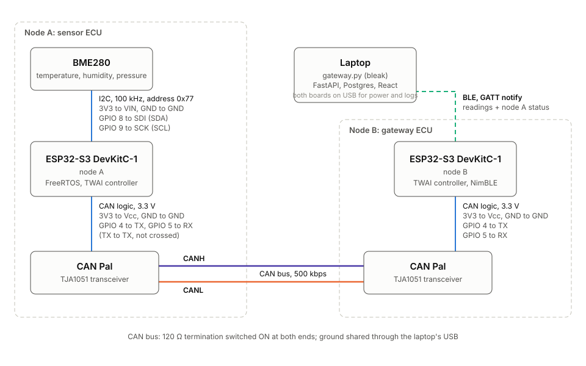

# ESP32 two node CAN sensor network

A tiny vehicle style network: a sensor ECU and a gateway ECU on a CAN bus, a BLE link to
a laptop, and a telemetry pipeline that ends in a live dashboard.

```
BME280 ─I2C─▶ node A ─CAN─▶ node B ─BLE─▶ gateway.py ─HTTP─▶ FastAPI ─▶ Postgres
              sensor ECU    gateway ECU      (laptop)                       │
                                                         React dashboard ◀──┘ WebSocket
```

- **Node A** (ESP32-S3) reads temperature, humidity and pressure from a BME280 with a
  driver written from the datasheet (raw register reads, no vendor library), runs it
  through FreeRTOS tasks and queues, and sends each reading plus a heartbeat on CAN.
- **Node B** (ESP32-S3) receives over CAN, watches node A's heartbeat to detect a dead
  node or a failed sensor, and republishes readings and status as a BLE GATT service.
- **The laptop** runs a Python BLE gateway that uploads to a FastAPI service backed by
  Postgres, and a React dashboard that charts everything live and shows node health.

Firmware is C++ (C for the BLE module) on ESP-IDF 5.5. The hardware is premade modules
wired on breadboards.

## Hardware

| Part | Role |
|---|---|
| 2x ESP32-S3-DevKitC-1 (N16R8) | node A and node B |
| Adafruit BME280 breakout | temperature, humidity, pressure over I2C |
| 2x Adafruit CAN Pal (TJA1051) | CAN transceivers, 3.3 V logic, onboard 120 Ω termination |



| Connection | Pins |
|---|---|
| ESP32 to BME280 (node A) | 3V3 to VIN, GND to GND, GPIO 8 to SDI (SDA), GPIO 9 to SCK (SCL) |
| ESP32 to CAN Pal (both nodes) | 3V3 to Vcc, GND to GND, GPIO 4 to TX, GPIO 5 to RX (straight, not crossed) |
| CAN Pal to CAN Pal | CANH to CANH, CANL to CANL; termination switch ON on both |

## Protocol

CAN at 500 kbps, standard 11 bit IDs, little endian payloads:

| ID | Frame | Payload |
|---|---|---|
| `0x100` | reading | temperature int16 (0.01 C), humidity uint16 (0.01 %RH), pressure uint32 (Pa) |
| `0x701` | node A heartbeat, 1 s | uptime uint32 (s), sensor_ok uint8 |

Node B's BLE service (`4a5c0001-...`) carries the reading byte for byte as received on
CAN (`4a5c0002-...`) and a 9 byte status (`4a5c0003-...`): online and sensor flags, node A
uptime, CAN error count. Details and the reasoning behind each choice are in
[docs/design.md](docs/design.md).

## Repository layout

```
firmware/node_a              sensor ECU: BME280 driver, FreeRTOS tasks, CAN transmit
firmware/node_b              gateway ECU: CAN receive, health tracking, BLE GATT server
firmware/components/         code shared by both nodes (the CAN frame format)
gateway/                     Python BLE client that uploads to the backend, with tests
backend/                     FastAPI service and Postgres schema
dashboard/                   React and Recharts live dashboard
docs/                        wiring diagram and design notes
tools/                       local helper scripts
```

## Running it

**Firmware** (ESP-IDF 5.5, ESP32-S3). From the repo root, activate ESP-IDF, then build
and flash each node with its board plugged into the port labeled UART/COM:

```bash
. ./env.sh
cd firmware/node_a && idf.py -p <node A port> flash monitor
cd ../node_b && idf.py -p <node B port> flash monitor
```

**Database and backend:**

```bash
docker compose up -d
cd backend && python3 -m venv .venv && .venv/bin/pip install -r requirements.txt
.venv/bin/uvicorn app.main:app
```

**Gateway** (needs Bluetooth permission for the terminal it runs in):

```bash
cd gateway && python3 -m venv .venv && .venv/bin/pip install -r requirements.txt
.venv/bin/python gateway.py
```

**Dashboard:**

```bash
cd dashboard && npm install && npm run dev
```

Then open http://localhost:5173.

**Tests:**

```bash
cd gateway && .venv/bin/python -m pytest
```

## Highlights

- BME280 compensation checked on the host against the datasheet's floating point
  formulas with the chip's real calibration constants.
- I2C bus recovery without a reboot, verified by shorting SDA to ground mid run.
- Heartbeat based health tracking: the gateway tells a dead node apart from a failed
  sensor, and the dashboard flags stale data the nodes cannot report themselves.
- CAN failures surfaced honestly: the TWAI driver returns success for frames that fail
  on the bus, so the transmit path checks the completion callback instead.

[docs/design.md](docs/design.md) covers the tradeoffs and the debugging along the way:
missing termination, a shorted screw terminal, and a logic analyzer that loaded the I2C
bus.

## Status

Working end to end. Outstanding: a decoded logic analyzer capture of the I2C traffic
(the clone analyzer used so far interferes with the bus), and a dashboard screenshot.
